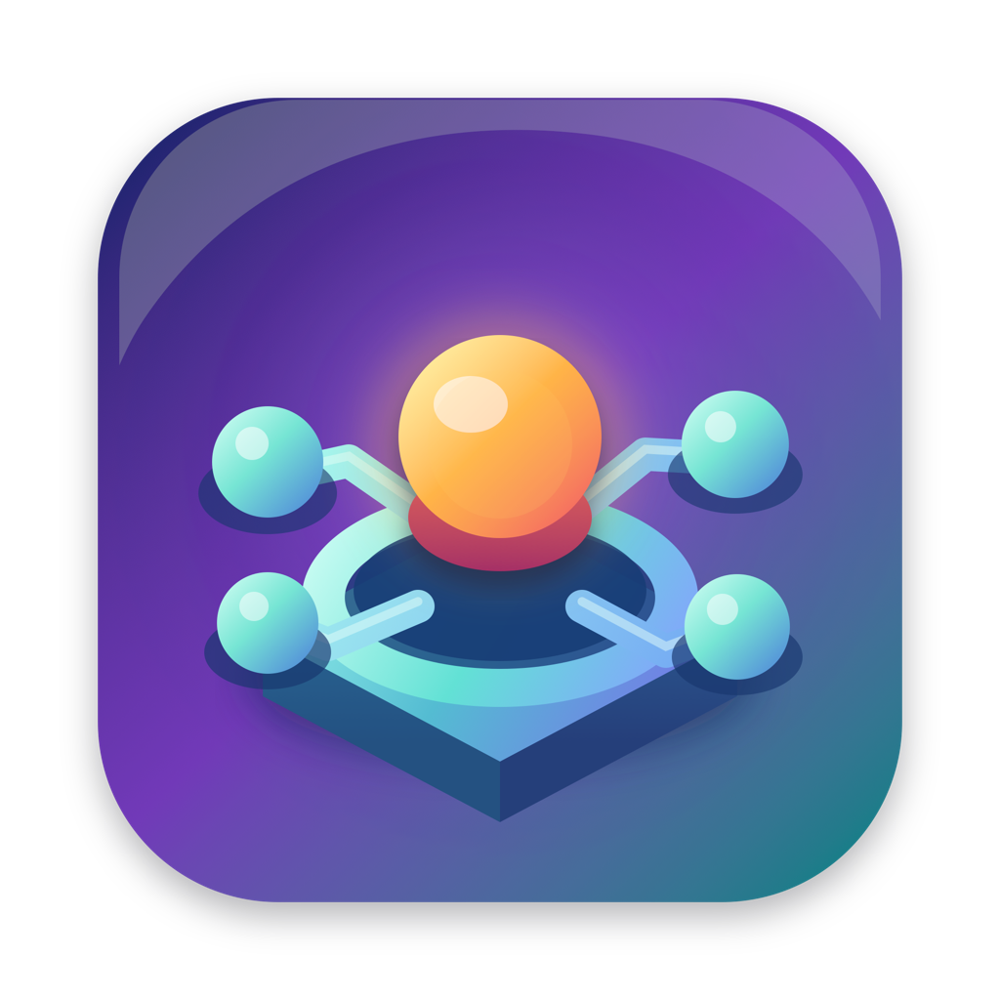

<p align="center"></p>

# UniHub

A native alternative to Unity Hub for Apple Silicon Macs, built with a Rust core and a
SwiftUI interface. It covers everyday work (your projects, your editors, your Unity
account and tools) in a ~5 MB app instead of a ~200 MB Electron one.

> UniHub is an independent project. It is not affiliated with or endorsed by Unity
> Technologies. "Unity" and "Unity Hub" are trademarks of Unity Technologies.

## Features

- **Projects:** your projects with editor version and last-modified time. Search,
  favourite, open, open with a specific editor, show in Finder. UniHub imports the
  official Hub's project list (read-only: it never writes to the Hub's files).
- **Source control and details:** a column with each project's branch and provider (GitHub,
  GitLab, other Git hosts, Unity Version Control, Perforce). The arrow on each row opens a
  details panel: render pipeline, current platform, scripting backend, packages, size on
  disk by folder, last commit, uncommitted changes, ahead/behind, Unity Cloud project, and
  links to the repository, branch, pull/merge requests and commits.
- **Clean Up:** free disk space from a project's menu or its details panel. In a git
  repository it offers the untracked files git ignores (never tracked or new uncommitted
  files); without git, only what Unity and IDEs regenerate: `Library`, `Temp`, `obj`,
  `Logs`, `.sln`/`.csproj` files, debug symbols and crash dumps. Ignored files nothing
  regenerates (builds, `UserSettings`, assets kept out of the repository) are listed but not
  selected. Refused while the project is open in Unity.
- **Installs:** editors in `/Applications/Unity/Hub/Editor`, the Hub's custom install
  path, and any extra folders you add, with their build platforms and language packs.
  **Modules…** adds platforms (Android with OpenJDK and the SDK/NDK, iOS, Web, Windows,
  Linux, tvOS, visionOS…), language packs and documentation, or removes installed ones.
  Editors can be uninstalled. License terms (e.g. the Android SDK's) must be accepted
  before installing, one checkbox per module.
- **Releases:** a Recommended tab like the Hub's "Official releases" (the newest release
  of each Supported and LTS line Unity still supports, grouped by Unity 6, 2022…), and
  LTS, Supported, Beta, Alpha and Tech releases for Apple Silicon, from Unity's public
  release API. Search finds any version across all streams, including
  older ones that only have an Intel build (they run with Rosetta 2).
- **Installing without Unity Hub:** Install on a release picks modules, checks disk space
  and installs through the official Unity CLI; progress shows on the release and on the
  Installs page, and installs can be cancelled.
- **Account and licenses:** sign in with your Unity ID, switch or sign out of accounts,
  see your licenses, activate Unity Personal or return licenses.
- **Tools:** install, update or uninstall the Unity CLI, and install, update or remove the
  tools it manages (Unity Version Control `cm`, Unity Gaming Services CLI, and more).
- **Settings (⌘,):** Accounts, Licenses, Appearance, Projects, Installs, Unity CLI, Advanced.
- **CLI:** `unihub projects | editors | releases | install | uninstall | modules |
  module-add | module-remove | open | add | remove | import | info | clean | account |
  login | logout | tools | tool-install | tool-remove | cli | cli-install | settings`.

### How sign-in and installs work

UniHub does not implement Unity's sign-in, licensing or installer itself. It runs Unity's official
command-line tool (`unity`, installed from UniHub's Tools page or from
<https://docs.unity3d.com/hub/unity-cli>) and reads its `--json` output. Sign-in happens
in your browser, and tokens stay in the macOS keychain, where the Unity CLI keeps them.
UniHub never sees your password or tokens. Editors and modules are downloaded, verified and
installed by the same CLI (`unity install`, `unity install-modules`), so Unity Hub does not
need to be installed or running.

## Requirements

- macOS 14 or later on Apple Silicon
- Rust (stable) with the `aarch64-apple-darwin` target
- Xcode 16 or later (Swift 6 toolchain)

## Build

```bash
./scripts/bundle-app.sh        # builds dist/UniHub.app
open dist/UniHub.app
```

For development:

```bash
./scripts/build-core.sh        # Rust core → XCFramework + Swift bindings (run after core changes)
cd apple && swift run          # or open apple/Package.swift in Xcode
cargo test                     # core tests
cargo run -p unihub-cli -- projects
```

After editing `apple/Resources/AppIcon.svg`, regenerate the app icon (the `.icns` is committed,
so normal builds don't need this step):

```bash
./scripts/make-icon.sh         # SVG → AppIcon.icns, rendered with WebKit
```

Launch arguments are handy while working on the UI:

```bash
dist/UniHub.app/Contents/MacOS/UniHub -page Tools -openSettings YES -settingsPane Licenses
dist/UniHub.app/Contents/MacOS/UniHub -detailsProject /path/to/project
dist/UniHub.app/Contents/MacOS/UniHub -cleanupProject /path/to/project
```

`unihub releases --version 2019.4` searches every stream; `unihub install 2022.3.62f3 -m ios
android android-sdk-ndk-tools --accept-terms` installs with progress; `unihub modules
6000.0.85f1` lists an editor's modules and `module-add` / `module-remove` change them.

`unihub clean <project>` lists what Clean Up would remove; add `--yes` to delete it, and
`--all` to include ignored files that are not regenerated.

## Layout

```
crates/unihub-core     Rust core, exported to Swift with UniFFI
  projects.rs          project list (own store + read-only import from the Hub)
  editors.rs           installed-editor discovery
  releases.rs          Unity's public release API
  settings.rs          UniHub preferences
  vcs.rs               Git / GitHub / GitLab / Unity Version Control / Perforce detection
  details.rs           project details panel and size on disk
  clean.rs             Clean Up: git-ignored or generated files, open-in-Unity check
  modules.rs           installed editors' modules (modules.json, or a folder scan)
  jobs.rs              background editor/module installs through the Unity CLI, with progress
  unity_cli.rs         sign-in, licenses and tools through the official Unity CLI
crates/unihub-cli      `unihub` command-line tool
crates/uniffi-bindgen  generates the Swift bindings
apple/                 SwiftUI app (Swift package)
apple/Resources        app icon: AppIcon.svg (source), AppIcon.icns, AppIcon-1024.png
docs/hub-behavior.md   how the official Hub behaves, written as a clean-room reference
```

## Contributing: clean-room rule

UniHub works with the official Hub's data files, Unity's public APIs and Unity's
official CLI. It must not contain code, images or text taken from Unity Hub. Base
contributions on observed behaviour, documented file formats (see `docs/hub-behavior.md`)
and public APIs. Do not paste code from Unity Hub, and do not reimplement Unity's
authentication, token handling or licensing protocols. Use the Unity CLI for those.

## License

Apache License 2.0. See [LICENSE](LICENSE).
